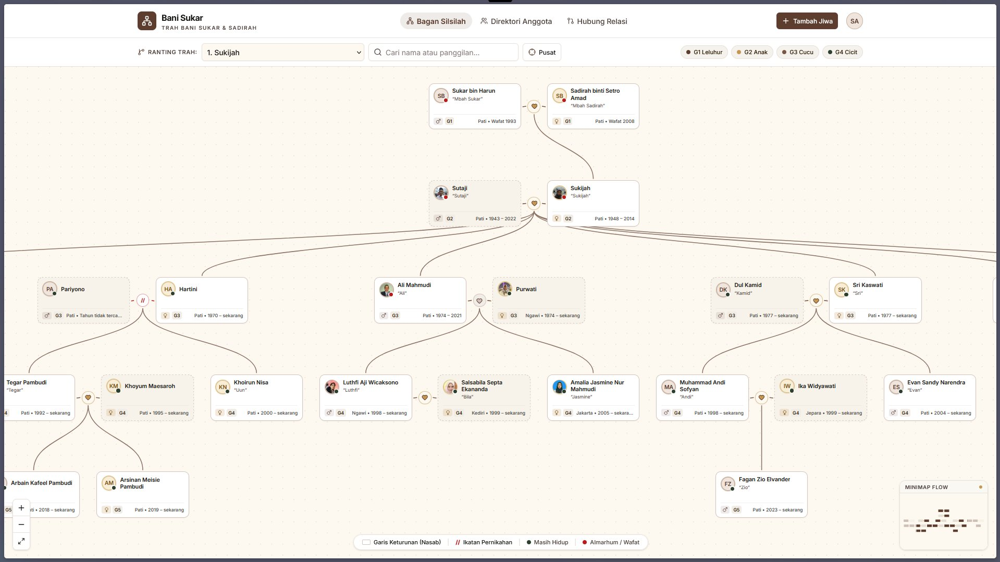
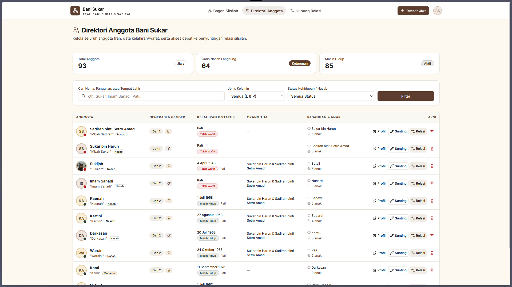

# Bani Sukar — Silsilah Keluarga Trah Sukar & Sadirah

Aplikasi web interaktif untuk mendokumentasikan, memvisualisasikan, dan mengelola pohon silsilah keluarga besar **Trah Bani Sukar & Sadirah**, lengkap dengan bagan silsilah interaktif, direktori anggota, profil individu, serta panel admin untuk pengelolaan data dan relasi keluarga.

## Tangkapan Layar

### 1. Bagan Silsilah Interaktif
Visualisasi pohon keluarga berbasis kanvas interaktif dengan filter **Ranting Trah**, pencarian nama/panggilan, tombol **Pusat**, legenda generasi (`G1 Leluhur`, `G2 Anak`, `G3 Cucu`, `G4 Cicit`, dst.), indikator status kehidupan, garis keturunan (nasab), ikatan pernikahan, serta **Minimap Flow**.



### 2. Direktori Anggota
Daftar seluruh anggota trah beserta ringkasan statistik (**Total Anggota**, **Garis Nasab Langsung**, **Masih Hidup**), pencarian berdasarkan nama/panggilan/tempat lahir, filter jenis kelamin dan status kehidupan/nasab, serta akses cepat ke halaman profil, penyuntingan, relasi, dan hapus data.



## Fitur Utama

- **Bagan Silsilah Interaktif (`/`)**: Kanvas pohon keluarga dengan zoom, pan, minimap, filter per ranting trah (`?cabang=`), dan fokus anggota (`?fokus=`).
- **Profil Anggota (`/anggota/[id]`)**: Menampilkan detail biodata anggota (nama lengkap, nama panggilan, jenis kelamin, tempat & tanggal lahir, status wafat, foto profil) beserta informasi orang tua, pasangan, dan anak.
- **Direktori & Manajemen Anggota (`/admin/anggota`)**: Daftar anggota lengkap dengan fitur tambah (`/admin/anggota/baru`), sunting (`/admin/anggota/[id]`), dan hapus data anggota termasuk unggah foto profil.
- **Manajemen Relasi (`/admin/relasi/[id]`)**: Pengaturan ikatan pernikahan (`married`, `divorced`, `widowed`) serta relasi orang tua–anak beserta urutan kelahiran.
- **Manajemen Pengguna Admin (`/admin/pengguna`) & Autentikasi (`/login`)**: Sistem login berbasis JWT untuk mengakses fitur pengelolaan data keluarga.

## Teknologi yang Digunakan

- **Framework**: [Next.js 16](https://nextjs.org) (App Router), React 19, TypeScript
- **Styling & UI**: Tailwind CSS v4, Lucide React, Sonner, `cmdk`
- **Visualisasi Graf**: [`@xyflow/react`](https://reactflow.dev/)
- **Database & ORM**: PostgreSQL dengan [Drizzle ORM](https://orm.drizzle.team/)
- **Validasi & Form**: React Hook Form, Zod
- **Autentikasi & Penyimpanan**: `jose` (JWT), `@aws-sdk/client-s3` (kompatibel dengan Supabase Storage S3)
- **Pengujian**: Vitest

## Memulai

### 1. Prasyarat

- Node.js (atau Bun)
- Database PostgreSQL (lokal atau Supabase)
- Bucket Supabase Storage S3-compatible (opsional, untuk unggah foto profil)

### 2. Instalasi

```bash
npm install
# atau
bun install
```

### 3. Konfigurasi Environment

Salin berkas `.env.example` menjadi `.env.local` dan sesuaikan nilainya:

```bash
cp .env.example .env.local
```

Variabel yang digunakan di `.env.example`:

- `DATABASE_URL` — URL koneksi PostgreSQL
- `JWT_SECRET` — Kunci rahasia JWT (minimal 32 karakter)
- `NEXT_PUBLIC_SUPABASE_URL` — URL proyek Supabase
- `SUPABASE_STORAGE_BUCKET` — Nama bucket penyimpanan foto (default: `person-photos`)
- `SUPABASE_S3_ENDPOINT`, `SUPABASE_S3_REGION`, `SUPABASE_S3_ACCESS_KEY_ID`, `SUPABASE_S3_SECRET_ACCESS_KEY` — Kredensial S3 Supabase Storage

### 4. Migrasi & Seed Database

Jalankan migrasi skema dan isi data awal:

```bash
npm run db:migrate
npm run db:seed
```

### 5. Jalankan Server Pengembangan

```bash
npm run dev
```

Buka [http://localhost:3000](http://localhost:3000) di browser Anda.

## Skrip yang Tersedia

| Skrip | Keterangan |
| :--- | :--- |
| `npm run dev` | Menjalankan server pengembangan Next.js |
| `npm run build` | Membangun aplikasi untuk produksi |
| `npm run start` | Menjalankan server produksi |
| `npm run lint` | Menjalankan ESLint |
| `npm run test` | Menjalankan unit test dengan Vitest |
| `npm run db:generate` | Membuat file migrasi Drizzle |
| `npm run db:migrate` | Menerapkan migrasi ke database |
| `npm run db:studio` | Membuka Drizzle Studio |
| `npm run db:seed` | Mengisi database dengan data awal |
